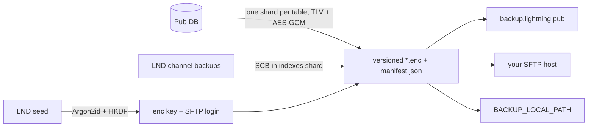

# Lightning.Pub — Backups and restore

How Pub backs up its accounting database and LND channel state, where it goes, and how restore works. Code lives in `src/services/backup/`; the managed server is the separate [PubFTPService](https://github.com/shocknet/PubFTPService) repo.

## What goes where

| | Dialtone shards (`<table>.v<generation>.enc`) + `manifest.json` |
|---|---|
| **What** | Users, balances, apps and their Nostr keys, settings, offers, grants… plus address count and LND multi-channel backup in the indexes shard |
| **Where** | Managed cloud SFTP, your own SFTP server, and/or a local folder |
| **Encrypted with** | Key derived from the LND seed (shards only; the manifest is plaintext JSON) |
| **Written by** | `backupManager.ts` (SCB via `unlocker` → channel-backup sink) |
| **Read by** | `restoreManager.ts` |



There is one secret: the LND seed. It unlocks both the dialtone encryption key and the SFTP login, so an operator never manages a separate backup password.

## Keys and formats

- **Derivation** (`derivation.ts`): Argon2id (64 MiB, t=3, salt `lightning-pub-backup/v1`) → HKDF-SHA256 → `encKey` (32 B), `sftpUser` (32 B hex), `sftpPass` (32 B hex). Each derivation version pins these parameters; **never change derivation v1**: every existing backup depends on it. Add a v2 instead.
- **Adding a derivation version.** The version decides the SFTP login too, so each version is a separate account and the version cannot be looked up before deriving. Restore must try versions newest-first (derive, log in, decrypt one shard; a wrong key fails the GCM tag) and stop at the first that works. A node that moves to a new version must immediately upload every shard under the new account, so the newest version with files is always complete. Today restore only uses the latest version, which is correct while v1 is the only one.
- **Envelope** (`encryption.ts`): `[version:1][iv:12][ciphertext][tag:16]`, AES-256-GCM. The tag rejects any tampered or truncated file before anything touches the DB.
- **Payload** (`segments.ts`): per-table version byte + TLV-encoded rows. IDs are UTF-8 (so names like `alice` and hyphenated UUIDs survive). Prices are decimal strings (so `1.5` does not fail the encode).
- **Shards** (`backupTables.ts`): 12 tables (`indexes`, `user_balances`, `tracked_providers`, `applications`, `application_users`, `admin_settings`, `app_user_devices`, `user_offers`, `products`, `management_grants`, `debit_accesses`, `invite_tokens`), each stored as an immutable `<table>.v<generation>.enc`. A batch that changes several linked tables shares one generation token. Unchanged tables keep their previous filename. `BACKUP_RESTORE_ORDER` is also the import order: balances first, so users exist before app links reference them.
- **Manifest** (`manifest.json`): plaintext JSON `{ version, generation, tables }` naming the selected file for every published table. `version` is the manifest schema; current writers use `1`, and a file that omits it is read as version 1. An unsupported version fails restore. Restore reads this file and downloads exactly those shards. A missing or corrupt manifest is a restore error. Each publish re-reads the destination's manifest and copies unchanged names from that read. Publication writes `manifest.json.tmp` (SFTP) or a sibling `.part` (local) and atomically renames over `manifest.json`. Shard bytes go straight to their unique names. Local shard files are fsynced, and the directory is fsynced, before the manifest is published. An incomplete shard is never referenced by the published manifest.
- **Indexes shard:** one row with the address count (TLV tag 2) and the multi-channel backup (TLV tag 3, chunked). A one-byte marker means the node had no channels; a missing tag 3 is refused. The row is written only once both the address count and the channel state are known, so a half-known snapshot cannot overwrite a good one. If either half is still unknown, the previous manifest entry is left in place.
- **Not backed up on purpose:** pending (unpaid) invoice payments. A restore may under-count in-flight money but never inflates balances.
- Machine-local admin settings are filtered out of the `admin_settings` shard (`mapAdminSettingBackupRow`).

## When uploads happen

- Managers call `notifyBackupTable(<table>)` after writes. Notifies that land in one debounce window become one snapshot and one manifest commit, so linked tables notified together are published atomically. Publish 30 s after the last change, but never deferred more than 5 min under continuous writes. A write that changes only one independent table still uploads only that shard; a child table also republishes its restore parents (`expandBackupTableDependencies`) from the same snapshot, so a concurrent insert cannot pair a new child shard with an old parent. Other manifest entries are copied forward. Bulk user deletes (`RemoveUsers`) take that same publish lock, then upload every table (`runExclusiveFullBackup`), so a live parent snapshot cannot drop a user while a retained child shard still names them. If that full publish fails, the manager keeps a full-refresh obligation and later queued batches export every table until a complete snapshot lands; merely re-dirtying all tables is not enough, because a narrow batch may already be waiting on the lock.
- Dirty tables are exported inside one DB read transaction, then that transaction is released before any network IO. Each destination re-reads its manifest, uploads the new shards to unique names, and only then atomically replaces `manifest.json`. Local shard writes fsync the file; the directory is fsynced before the manifest's sibling `.part` is fsynced and renamed. SFTP shards use a plain upload that finishes only after the server acknowledges CLOSE; the manifest requires OpenSSH `posix-rename@openssh.com` so the rename overwrites atomically. An SFTP session is cancelled as a failure if it has not finished in 60 seconds (handshake still fails in 15 seconds if the server never answers; a transfer that stops making progress fails in 20 seconds). A server that lacks it fails the upload and is flagged incompatible (no unlink-then-rename fallback, which could delete the last good copy). A destination that fails a shard does not write a new manifest. If the manifest replace throws, the destination is re-read: shards that landed are kept when the published manifest names them, and deleted when it does not. After a successful replace, shards the new manifest does not name are deleted immediately. A crash before that cleanup is recovered on the next publish, which lists the directory and removes shard files the manifest does not name, including leftovers from a crashed upload, before uploading new ones. Listing or delete errors are logged and do not fail the backup; a delete that fails is retried on the next publish.
- On startup, after LND address/channel snapshots and default-app setup, **every** table is uploaded once (`uploadAllTables`). Empty tables still get a shard file, so a newly enabled destination is restorable without waiting for those tables to be written in live traffic. Indexes is skipped until both LND snapshots have run, so a previous indexes copy is not replaced with an incomplete row. If no destination succeeds (for example the only remote is unreachable), the failure is logged as a warning and startup continues; failed batches still retry with backoff. The same applies to the other full-flush callers below.
- The same full upload runs when remote backup is turned on. Bulk user deletes use `runExclusiveFullBackup` so the full upload cannot interleave with a live parent-only batch.
- On graceful shutdown (SIGINT/SIGTERM), pending timers are cancelled and an in-flight remote upload is detached so it cannot sit in front of the final snapshot. **Every** table is then written while the DB is still open. Remotes already running, and remotes started for this flush, get at most 15 seconds; that cap still applies when the only destination is remote or the local write failed. Indexes is uploaded only after both an address-count snapshot and a channel-backup snapshot. Startup takes those from LND (including address count 0 and the no-channels marker). If either half has not run, or it failed, the indexes upload leaves any existing manifest entry in place.
- Live channel changes update the sink through LND's backup subscription; startup also runs an explicit export so a quiet node still gets a first SCB into the indexes shard.
- Each destination is tried independently and commits its own manifest; an upload counts as done if any destination succeeds.

## Destinations and settings

| Setting | Meaning |
|---|---|
| `BACKUP_CLOUD_ENABLED` | Managed cloud. Host, port, and host key are built in; nothing else to configure |
| `BACKUP_SFTP_ENABLED` | Your own SFTP server, configured by the settings below |
| `BACKUP_SFTP_HOST` / `BACKUP_SFTP_PORT` | Your server (port defaults to 22) |
| `BACKUP_SFTP_USER` / `BACKUP_SFTP_PASS` | Optional explicit login; unset = seed-derived login |
| `BACKUP_SFTP_HOST_FINGERPRINT` | Your server's host key (`SHA256:…`). Unset = connect anyway and log the observed fingerprint so you can pin it. A value that is empty after stripping `SHA256:` / padding is refused; it is not treated as unpinned |
| `BACKUP_LOCAL_PATH` | Also write the same versioned shards and `manifest.json` to this folder |

At least one destination must be set for dialtone uploads to run. Backups need Pub to hold the node's seed (it does when Pub created or restored the wallet).

The wizard's backup step and the admin `remote_backup` setting write the cloud and SFTP settings above, defaulting to the managed cloud. An empty host selects the cloud; a host selects your SFTP server. The password is never returned, and an empty one keeps the saved password for the same host and user. Setting any of these in the environment locks the remote destination for both. `BACKUP_LOCAL_PATH` is environment-only.

## Managed cloud (`backup.lightning.pub`)

- **Server:** PubFTPService: SFTP on port 22, sign-up API over HTTPS on the same hostname. Ops docs are in that repo (`docs/RUNBOOK.md`).
- **Host key pinning** (`sftpClient.ts`): the cloud fingerprint `SHA256:3bEOvUFGn+Ts/kfRtKV5AGd3j4AAoWM2c60w9pSpdM8` is compiled in and always enforced. A mismatch refuses to connect. Rotating the server key therefore needs a Pub release. Pointing `BACKUP_SFTP_HOST` at `backup.lightning.pub:22` also gets the pin.
- **Sign-up** (`cloudProvision.ts`): the server only accepts accounts created with a proof of work. When a cloud login is rejected (`SftpAuthError`), `BackupManager` fetches a challenge, solves it, POSTs `/v1/provision`, and retries the upload. 409 "already exists" counts as success. Concurrent shard uploads share one sign-up. The solver yields to the event loop every 5,000 hashes (stalls under 10 ms). At the server's 18 bits it averages about 1.8 s on a slow single core (~150k hashes/s) and 0.35 s on a fast desktop; 1 in 100 solves takes about 4.6 times the average. Difficulty must be an integer from 0 through 22; anything else (including fractions, negatives, and `NaN`) is refused.
- **Server-side limits Pub may see:** 429 (per-IP rate limit, retried on the next upload), 507 (server disk full), 10 MiB quota per node.

## Restore

Entry points: the wizard's `WizardRestore` RPC and the CLI:

```bash
node build/src/index.js restore --phrase "<24 words>" --source cloud|ftp|local \
  [--ftp-host host] [--ftp-port 22] [--ftp-host-fingerprint SHA256:...] \
  [--ftp-user u --ftp-pass p] [--local-path dir]
```

Flow (`RestoreManager.RestoreFromSource`):

1. Refuse unless the DB is clean (no apps, users, app users, or node info), except when resuming from a checkpoint (below).
2. Derive keys from the phrase, fetch `manifest.json` from the chosen source, then the shards it names. A missing or corrupt manifest stops the restore (no backup set). **Every shard in `BACKUP_RESTORE_ORDER` must be present in the manifest.** A missing file stops the restore with `failureMessage()` for each missing name (the login succeeded and that file is not there). A file that decrypts to zero rows is an empty table and is imported, except `indexes`, which must be exactly one row with address count and SCB (or the no-channels marker). A count of 0 is valid. An empty `applications` table still stops the restore. Unreferenced objects in the directory, including a newer shard that is not in the manifest, are ignored. A rejected cloud login throws `CloudLoginRejectedError` and stops the restore; it is not reported as a missing file. Host-key mismatch and other connection errors keep their own messages.
3. Decrypt the shards. The SCB travels in the indexes shard; there is no separate relay fetch.
4. In one DB transaction: import all dialtone tables, then initialize LND from the seed (recovery window scales with the backed-up address count).
5. Wait for LND, save the seed. If the backup has channels, restore the SCB (`ApplyScb`); if it marks no channels, skip apply. A failed SCB apply leaves the checkpoint at `LND_ACTIVE` so the same phrase can retry. The SCB from the first successful fetch is stored in `.restore_scb` so a retry cannot apply a different (older) channel backup from the source. Restore only reports success after this step and the checkpoint is `COMPLETED`.

Progress is recorded in `.restore_checkpoint` in the data dir (`STARTED` → `LND_RECOVERED` → `DB_COMMITTED` → `LND_ACTIVE` → `COMPLETED`) so a crash can resume only when that checkpoint is complete and consistent. A SHA-256 of the normalized restore phrase is stored in `.restore_phrase_hash` and checked on resume, so a later call cannot finish with a different seed. `STARTED` and the phrase hash are written together, only after every shard is fetched and decrypted, just before the DB import and LND init. The SCB is bound at the same time. A restore that fails earlier (wrong phrase, missing shard, or a shard that cannot be decoded) leaves no checkpoint, so the operator can try another phrase or set the node up fresh. After `DB_COMMITTED` or `LND_ACTIVE`, restore refuses unless LND still has a wallet, this database is not empty, and the phrase binding is present. `LND_ACTIVE` also requires `.restore_wallet_pub` from the first time LND reported identity, and refuses a different connected wallet. Incomplete or mismatched state is not resumable; the error tells the operator to delete the checkpoint files, reset LND and the database, and retry from a clean node. A fresh restore still refuses if a wallet exists or the DB is not empty. `LND_RECOVERED` is a broken state and is refused the same way.

**Startup gate:** if `.restore_checkpoint` exists and is not `COMPLETED` (including `STARTED`), normal startup enters recovery-only mode: the wizard is brought up so `WizardRestore` can finish, and the main server does not start until the checkpoint is `COMPLETED`. The gate blocks the main server, never the wizard: it is created before the gate (even when `WIZARD` is disabled) and the gate waits in a loop, so a retry that fails again leaves the process and its wizard up for another attempt instead of exiting. Waiters are notified only after the in-flight restore flag is cleared, so a successful wizard restore cannot leave startup blocked. A restore started from the wizard is also waited out before the no-wallet `Unlock()`, which would otherwise create a fresh wallet and destroy the restore. The `restore` CLI is an alternative entry point (it runs before `initMainHandler` and exits). An operator abandoning a failed restore must delete `.restore_checkpoint`, `.restore_phrase_hash`, `.restore_wallet_pub`, and `.restore_scb`, reset LND and the database, then restart Pub; a running process keeps waiting until a restore completes. While recovery is active, wizard config is refused so it cannot unlock the node mid-restore. The instance lock means the CLI cannot run while a recovery-only process is already holding the data dir.

**Wizard retry:** `GetServiceState` reports `has_ongoing_recovery` from `IsRecoveryActive()`. The welcome page shows **Retry Restore** (not **Edit Setup**) when that flag is set, because a committed restore leaves `is_db_clean` false and setup is refused until the checkpoint completes. A failed restore that still has an open checkpoint stays on the restore-source step with the error; "No Backup Found" is only for failures that left no checkpoint.

Sources: **cloud** (seed-derived login, pinned; a rejected login is a login error, and a reachable account missing the manifest or any named shard is reported with `failureMessage()` for each missing file), **ftp** (your host + port + host-key fingerprint; pointing at `backup.lightning.pub:22` without a fingerprint still pins the managed key), **local** (a folder of `manifest.json` plus the versioned shards it names).

## Your own SFTP server

OpenSSH is required (`posix-rename@openssh.com`) so `manifest.json` can be replaced atomically. Pub will not publish to a server that cannot atomically overwrite that file; the destination is flagged incompatible and further SFTP uploads fail until restart. Pub uploads bare filenames into the login's starting directory.

```bash
sudo groupadd sftpbackup
sudo useradd -g sftpbackup -s /usr/sbin/nologin -M pubbackup
sudo passwd pubbackup                         # or use Pub's seed-derived login
sudo mkdir -p /srv/pubbackup/chroot/upload
sudo chown root:root /srv/pubbackup/chroot && sudo chmod 755 /srv/pubbackup/chroot
sudo chown pubbackup:sftpbackup /srv/pubbackup/chroot/upload
```

`/etc/ssh/sshd_config.d/pubbackup.conf`:

```
Match User pubbackup
    ChrootDirectory /srv/pubbackup/chroot
    ForceCommand internal-sftp -d /upload
    AllowTcpForwarding no
    X11Forwarding no
```

The chroot top level must be root-owned and read-only, so `-d /upload` starts sessions in the writable folder. (Not yet tested end to end against OpenSSH.) Then `sudo sshd -t && sudo systemctl reload ssh`, and in Pub set `BACKUP_SFTP_ENABLED=true`, `BACKUP_SFTP_HOST`, and `BACKUP_SFTP_HOST_FINGERPRINT` from `ssh-keygen -lf /etc/ssh/ssh_host_ed25519_key.pub` on the server. Stock OpenSSH cannot restrict filenames; use a quota and a dedicated account.

## Invariants for contributors

- Adding a table to backups means: `backupTables.ts` (including `BACKUP_TABLE_PARENTS` if restore joins it to another shard), an encoder/decoder in `segments.ts`, export in `BackupManager`, import in `RestoreManager`, **and** the allowlist in PubFTPService `src/allowlist.ts`. Parent-row deletions must go through `runExclusiveFullBackup`, not a live `notifyBackupTable` of the parent alone. A failed exclusive full refresh must keep that obligation until a later batch publishes every table; a partial must not land on a destination that still has pre-delete child shards. The cloud must accept `manifest.json`, `manifest.json.tmp`, and `^(indexes|user_balances|...)\.v[0-9a-z]+\.enc$`. Otherwise the cloud rejects the new names. This repo does not update PubFTPService.
- Never change derivation v1 or the envelope version 1 layout.
- The cloud fingerprint in `sftpClient.ts` must match `/var/lib/pubftp/keys/host.key.pub` on the server.
- The wizard has no login. It is for Start9 and Umbrel, which publish that UI only on the appliance network (Start9: LAN-only, port 1777). Pub listens on every interface; the appliance is the access control. See the comment above `GuestAuthGuard` in `src/services/wizard/index.ts`.

## Open issues

- Custom hosts are not trust-on-first-use; pinning is manual.
- Longer term: log in to SFTP with a seed-derived SSH key instead of a password, so a captured login cannot be replayed.
