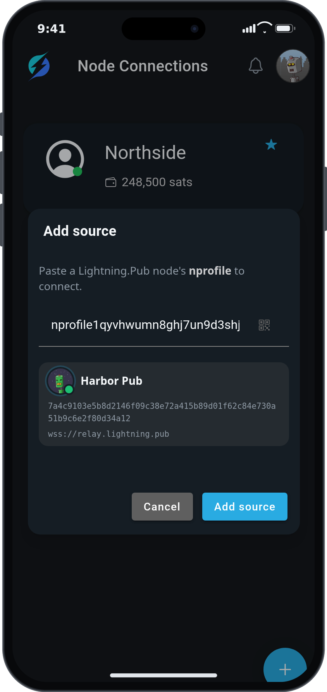
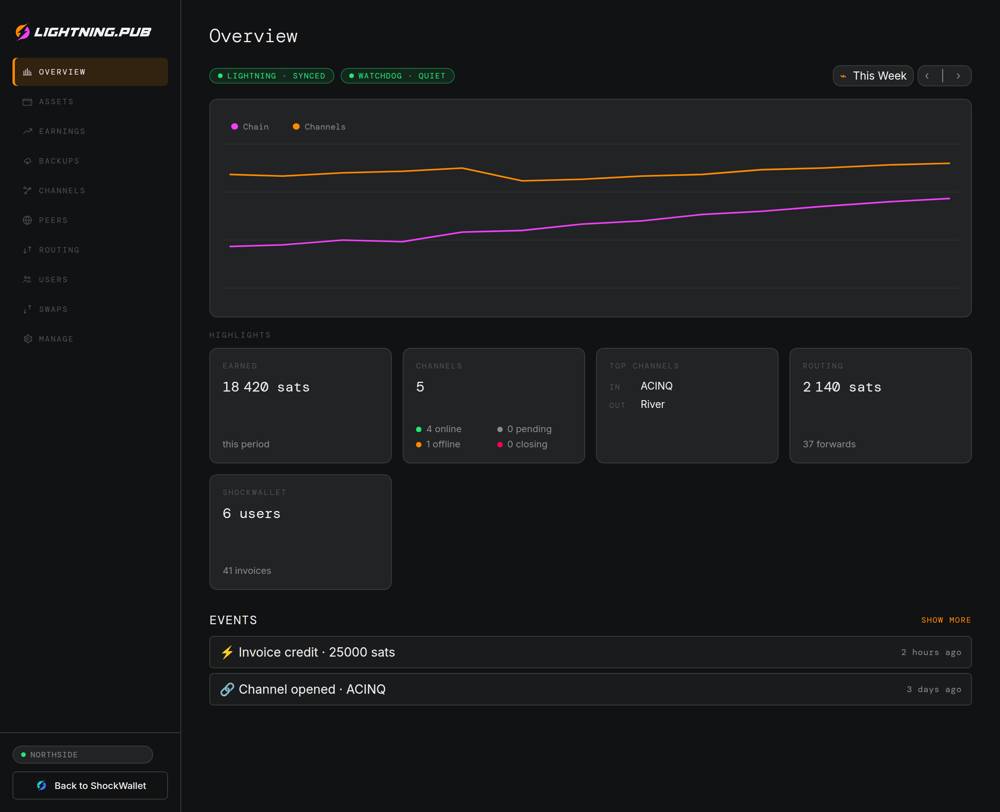
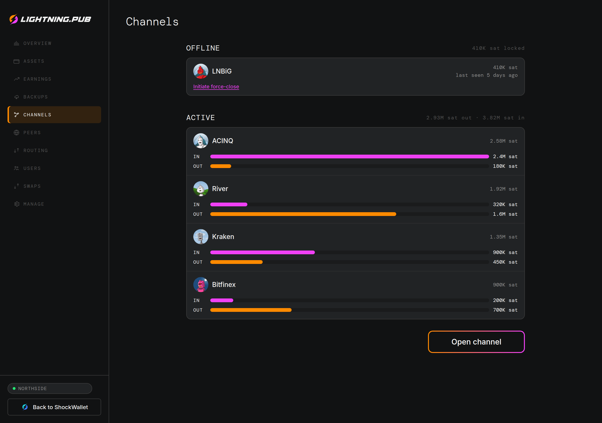
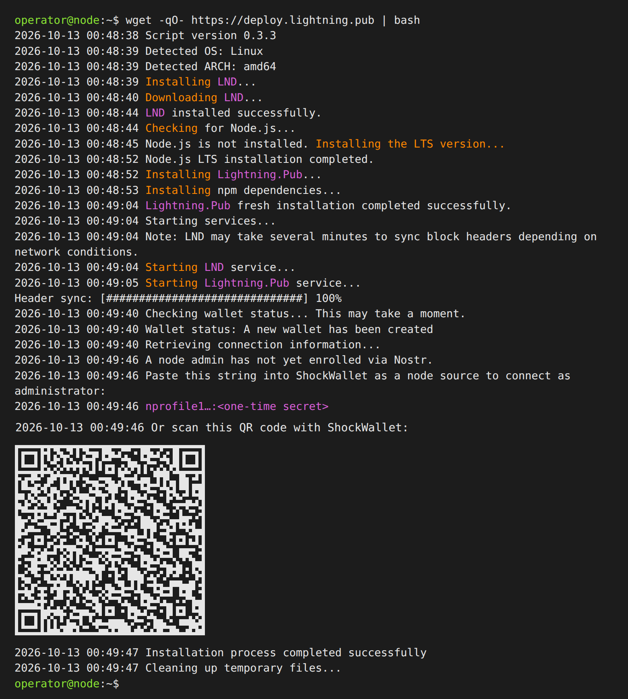

<picture>
  <source media="(prefers-color-scheme: dark)" srcset="readme/lightning-pub-dark.svg">
  
</picture>


[](https://github.com/shocknet/Lightning.Pub/pulls)
[](https://t.me/ShockBTC)
[](https://x.com/ShockBTC)

### Don't just run a Lightning Node, run a Lightning Pub.

"Pub" is a [Nostr](https://nostr.info)-native account system designed to make running Lightning infrastructure for your friends/family/customers easier than previously thought possible.

Lightning payments open the door to a new internet, but because of UX challenges with sovereignty we've seen a much slower uptake than we should for something so profound.

It may come as a surprise that the biggest hurdle to more adoption via Family and entrepreneurial Lightning nodes hasn't been with Bitcoin/Lightning node management itself, as we've seen that liquidity is easily automated, but rather the legacy baggage of traditional Client-Server web infrastructure. Things like IPv4, Reverse Proxies, DNS, Firewalls and SSL certificates, all require a personal configuration that is a hurdle for most.

Tor as a workaround has proven too slow and unreliable, and a dead-end for clearnet-web usecases.

Mobile nodes are easy to use for spending, but channels for every device is expensive and unscalable. Their utility suffers from the limitations of the node not being an always-online server. Not earning revenue while you sleep is  how Lightning becomes an act of ideological charity that loses you money.

Pub solves these challenges with a P2P-like design that is also web-friendly, by implementing a full RPC that is Nostr-native. Being Nostr-native eliminates the complexity of configuring your node like a server by using commodity Nostr relays. These relays, unlike LNURL proxies, are trustless by nature of Nostr's own encryption spec (NIP44).

Pub is also the reference server for the [CLINK](https://clinkme.dev) protocol, a Nostr-native successor to LNURL for Zaps, product and service sales, and an OAuth-style connection between a wallet and an app. Operators who still need LNURL or a Lightning Address can use a bridge, or put a reverse proxy in front of Pub's own HTTP endpoints.

By solving the networking and programmability hurdles, Pub provides Lightning with a 3rd layer that enables Node-Runners, Businesses, and Uncle Jims to easily onboard their personal network into Bitcoin's permissionless economy. 

Pub runners keep the Lightning Network decentralized with localized scaling that replaces large faceless custodians and centralized crypto-theater.

## Table of Contents
- [Features](#features)
- [Planned Features](#planned-features)
- [Installation](#installation)
  - [One-Line Deployment](#one-line-deployment)
  - [Docker Installation](#docker-installation)
  - [Manual CLI Installation](#manual-cli-installation)
- [Usage Notes](#usage-notes)
  - [Connecting to ShockWallet](#connecting-to-shockwallet)
  - [Lightning Address](#lightning-address)
- [Advanced Configuration](#advanced-configuration)
  - [Custom Nostr Relay](#custom-nostr-relay)
  - [Bootstrap Liquidity Provider](#bootstrap-liquidity-provider)
  - [Backups](#backups)
  - [Custom Lightning Address Domain](#custom-lightning-address-domain)
  - [Setup Wizard (Start9 and Umbrel)](#setup-wizard-start9-and-umbrel)
- [Support Development](#support-development)

## Features

- **Zero Network Configuration Required** - No port forwarding, Tor setup, firewall rules, or DNS configuration needed! Pub uses Nostr relays for all communication, making it perfect for users who want sovereignty without networking complexity.
- Wrapper for [`LND`](https://github.com/lightningnetwork/lnd/releases) that can serve accounts over LNURL and NOSTR
- A growing number of [methods](proto/autogenerated/client.md)
- Automated Channels
  - Receives quotes from multiple LSPs including Zeus and Flashsats
- Bootstrap Peering
  - A pub node may trust another pub node until it can afford a channel
  - Can be disabled via environment variable for full sovereignty
- Accounts for Applications and Users
  - Each user has their own balance, and an application is how a wallet or service connects to the node
  - A service fee (`SERVICE_FEE_BPS`) lets the node operator charge users
- Encrypted Backups and Restore
  - User balances and channel state, recoverable from the LND seed. See [Backups](#backups)
- **Complete Lightning Solution** - No additional LN node or Bitcoin full node required (The installer bundles LND configured with Neutrino)

- Connecting via ShockWallet is as easy as pasting an nprofile
- Or use a link to share your nprofile with friends and family



## Planned Features

- [x] A node management dashboard in [ShockWallet](https://github.com/shocknet/wallet2)
- [x] Nostr native [CLINK](https://clinkme.dev) "offers"
- [x] Encrypted Push Notifications
- [x] Encrypted Backups and Restore
- [-] Swap integration (Disabled for now)
- [ ] P2P "LSP" coordination for channel batching over Nostr
- [ ] High-Availability / Clustering

The dashboard opens after you pair the admin string (see [Connecting to ShockWallet](#connecting-to-shockwallet)).

**Overview** shows what the node earned over a period, which channels are up, and the latest events:



**Channels** lists each channel's inbound and outbound balance. An offline channel stays on the list with its local balance locked:



## Installation

### One-Line Deployment

Paste one-line and have a Pub node in under 2 minutes. It uses neutrino so you can run it on a $5 VPS or old laptop.

This method installs all dependencies and creates user-level services (systemd on Linux, launchd on macOS).

**Platform Support:**
- ✅ **Debian**: Fully tested and supported
- ✅ **Ubuntu**: Fully tested and supported
- ✅ **Arch**: Fully tested and supported
- ✅ **Fedora**: Fully tested and supported
- ✅ **macOS**: Fully supported with launchd service management

> [!IMPORTANT]
> **System Requirements:**
> - **RAM**: Minimum 2GB burstable in headless containers or VPS. 4+GB recommended for full Linux Desktop OS.
> - **Storage**: 20GB of space for compact blocks.
> - **Network**: No port forwarding, Tor, or firewall configuration needed! Pub uses Nostr relays for communication to eliminate traditional server networking requirements.

> [!TIP]
> **Bundled Node**: The Lightning.Pub install script provides a complete Lightning solution. You do NOT need to a full Bitcoin or other node, perfect small devices like Raspberry Pi.

To start, run the following command:

**Linux:**
```bash
wget -qO- https://deploy.lightning.pub | bash
```

**macOS:**
```bash
curl -fsSL https://deploy.lightning.pub | bash
```

It should look like this when it finishes (the admin string is redacted):



**Note:** The installation is confined to user-space, meaning:
- No sudo required for installation
- Pub's files are in `$HOME/lightning_pub/`. LND is in `$HOME/.lnd`. On Linux, a root install puts Pub in `/opt/lightning_pub/` instead; LND is still `$HOME/.lnd`
- **Linux**: Services managed via systemd (user-level)
- **macOS**: Services managed via launchd with convenient aliases

**After Installation:**
- The installer will display an admin connection string (nprofile and secret separated by a colon) and a **terminal QR code** for easy mobile setup
- The QR code is displayed directly in your terminal - simply scan it with ShockWallet's node connection flows
- You can also copy/paste the connection string into ShockWallet if you prefer
- The same string is saved to `~/lightning_pub/admin.connect`, and Pub deletes that file once a wallet has enrolled as admin
- Connection info is also available via web browser on Start9 and Umbrel appliances (releases forthcoming)

Please report any issues to the [issue tracker](https://github.com/shocknet/Lightning.Pub/issues).

#### Automatic updates

These are controversial, so we don't include them. You can however add a line to your crontab to re-run the installer on your time preference and it will gracefully handle updating:

**Linux:**
```bash
# Add to user's crontab (crontab -e) - runs weekly on Sunday at 2 AM
0 2 * * 0 wget -qO- https://deploy.lightning.pub | bash
```

**macOS:**
```bash
# Add to user's crontab (crontab -e) - runs weekly on Sunday at 2 AM
0 2 * * 0 curl -fsSL https://deploy.lightning.pub | bash
```

**Note:** The installer will only restart services if version checks deem necessary.

#### Troubleshooting

If the installation fails or services don't start properly, use these commands to diagnose:

**Linux:**
```bash
# Check service status
systemctl --user status lnd
systemctl --user status lightning_pub

# View logs
journalctl --user-unit lnd -f
journalctl --user-unit lightning_pub -f

# Restart services if needed
systemctl --user restart lnd
systemctl --user restart lightning_pub
```

**macOS:**
After installation, run `source ~/.zshrc` (or `source ~/.bash_profile`) to enable the convenience aliases, or open a new terminal. Then use:

```bash
# Check service status
lpub-status

# View logs
lpub-log      # Lightning.Pub logs
lnd-log       # LND logs

# Control services
lpub-start    # Start both services
lpub-stop     # Stop both services
lpub-restart  # Restart both services
```

**All Platforms:**
```bash
# Retrieve admin connection string (if installation completed but you need to find it again)
cat ~/lightning_pub/admin.connect

# Reset admin access (generates new admin.connect automatically)
rm ~/lightning_pub/admin.npub
sleep 1  # Wait briefly for new admin.connect to re-generate
cat ~/lightning_pub/admin.connect
```

### Docker Installation

See the [Docker Installation Guide](DOCKER.md).

### Manual CLI Installation

1. Run [LND](https://github.com/lightningnetwork/lnd/releases) if you aren't already:

```bash
./lnd --bitcoin.active --bitcoin.mainnet --bitcoin.node=neutrino --neutrino.addpeer=neutrino.shock.network --feeurl=https://nodes.lightning.computer/fees/v1/btc-fee-estimates.json
```

2. Download and Install Lightning.Pub (Node.js 24 or newer):

```bash
git clone https://github.com/shocknet/Lightning.Pub && cd Lightning.Pub && npm i
```

3. Configure values in the env file:

```bash
cp env.example .env && nano .env
```

4. Start the service:

```bash
npm start
```

## Usage Notes

### Connecting to ShockWallet

**For Administrators:**
1. After installation, you'll see an admin connection string (format: `nprofile1...:token`) and a **terminal QR code** containing the same admin connection string
2. **Option 1**: Scan the terminal QR code directly with ShockWallet's "Add Source" feature (mobile or web) to pair as administrator
3. **Option 2**: Copy/paste the connection string into ShockWallet's node connection screen

**For Guest Users:**
- The guest nprofile (without admin token) is stored in `$HOME/lightning_pub/app.nprofile`
- Share the nprofile string with guests directly, or use invitation links from the "Invite" page in ShockWallet
- Guests paste the nprofile string into ShockWallet's "Add Source" feature to connect

> [!NOTE]
> Connecting with wallet will create an account on the node, it will not show or have access to the full LND balance. Allocating existing funds to the admin user will be added to the operator dashboard in a future release.

### Lightning Address

When you run your own Lightning Pub, obtaining a Lightning Address is fully automated in ShockWallet. The wallet automatically:
1. Takes the CLINK offer from your Pub
2. Enrolls it at a LNURL bridge (creates a `@shockwallet.app` address)
3. This makes the Lightning Address trustless when payers support CLINK as it uses Nostr for communication instead of trusting the bridge to serve the correct invoice.

> [!TIP]
> **CLINK Integration**: Your Pub's CLINK offers enable ShockWallet to connect to CLINK-compatible services, like [Stacker News](https://stacker.news), allowing you to send and receive payments without additional setup.

For custom Lightning Address domains, see the [Advanced Configuration](#custom-lightning-address-domain) section.

## Advanced Configuration

Copy `env.example` to `.env` and customize settings:
```bash
cp env.example .env
nano .env  # or use your preferred editor
```

> [!IMPORTANT]
> A key set in `.env` beats the same key in `admin_settings`. On startup Pub writes the environment value into that table. The dashboard will not change a field while its variable is set; remove it and restart to edit it there.

### Custom Nostr Relay

By default, Lightning.Pub uses the ShockNet relay. To use your own:

```bash
# Single relay
NOSTR_RELAYS=wss://your-relay-url.com

# Multiple relays (space-separated)
NOSTR_RELAYS="wss://relay1.com wss://relay2.com wss://relay3.com"
```

### Bootstrap Liquidity Provider

By default, Lightning.Pub connects to a bootstrap liquidity provider (another Pub over Nostr) for outbound routing when local LND channel liquidity is low. Pub compares rates from top LSPs and automatically requests a channel when needed.

Settings are loaded from environment variables or the `admin_settings` database table (env wins if both are set). The relevant keys are **`PROVIDER_NPROFILE`** and **`DISABLE_LIQUIDITY_PROVIDER`**

```bash
# Disable upstream provider checks (LND only for outbound payments)
DISABLE_LIQUIDITY_PROVIDER=true

# Optional: point at a different Pub instance (pubkey + relay are in the nprofile)
PROVIDER_NPROFILE=nprofile1qyd8wumn8ghj7um5wfn8y7fwwd5x7cmt9ehx2arhdaexkqpqwmk5tuqvafa6ckwc6zmaypyy3af3n4aeds2ql7m0ew42kzsn638q9s9z8p
```

### Backups

Pub backs up user balances and channel state with one secret, the LND seed. Each table is encrypted on the node before it is uploaded, so the server that stores it cannot read it. Choose where the files go:

- **Managed backup server**: nothing to set up. The login is derived from the seed, so the same 24 words find the backup on restore.
- **Your own SFTP server**: a host and, if you have it, the server's host-key fingerprint (`ssh-keygen -lf` on that machine).
- **A folder on this machine**: `BACKUP_LOCAL_PATH` (environment only).

With none of these set, every file stays on this disk, and a dead disk can take channel funds and user balances with it.

```bash
# Managed backup server
BACKUP_CLOUD_ENABLED=true

# Or your own SFTP server
BACKUP_SFTP_ENABLED=true
BACKUP_SFTP_HOST=sftp.example.com
BACKUP_SFTP_HOST_FINGERPRINT=SHA256:...

# And/or a local folder
BACKUP_LOCAL_PATH=/var/backups/lightning-pub
```

The seed phrase by itself restores on-chain funds. Channel funds and Pub balances also need a current backup. Restore from the CLI. See [BACKUPS.md](BACKUPS.md) for the file layout and commands.

### Custom Lightning Address Domain

By default, ShockWallet automatically enrolls your CLINK offer at `@shockwallet.app`. For custom domains, you have two options:

**Option 1: Run your own [Bridgelet](https://github.com/shocknet/bridgelet)**

A minimalist LNURL-P and Lightning Address bridge service that uses CLINK Offers. This gives you full control over your Lightning Address domain without trusting third-party bridges.

**Option 2: Enable LNURL directly on Pub**

```bash
# Configure which LNURL bridge to suggest to wallets (default: https://shockwallet.app)
BRIDGE_URL=https://your-bridge.com

# Enable LNURL callbacks directly on Pub (requires SSL reverse proxy pointing to Pub's port)
SERVICE_URL=https://yourdomain.com
```

### Setup Wizard (Start9 and Umbrel)

The wizard is a web UI for first-run setup: node name, relay, liquidity, backups, and restore. It is intended for appliance UIs like Start9 and Umbrel, which open it on the appliance's own network. The one-line installer does not enable and non-Umbrel/StartOS systems do not need it.

```bash
WIZARD=true
```

It listens on every interface at `PORT + 1` (1777 by default) and has no password, so only enable it on a trusted network where that port is not reachable from the internet.

### Complete Reference

See `env.example` for complete documentation of all available settings.

For additional documentation, guides, and FAQs, visit [docs.shock.network](https://docs.shock.network) or contribute to the [docs repository](https://github.com/shocknet/docs).

## Support Development

> [!IMPORTANT]
> ShockWallet and Lightning.Pub are free software. If you would like to see continued development, please show your [**support**](https://github.com/sponsors/shocknet) 😊


## Warning

> [!WARNING]
> While this software has been used in a high-profile production environment for several years, it should still be considered bleeding edge. Special care has been taken to mitigate the risk of drainage attacks, which is a common risk to all Lightning APIs. An integrated Watchdog service will terminate spends if it detects a discrepancy between LND and the database, for this reason **IT IS NOT RECOMMENDED TO USE PUB ALONGSIDE OTHER ACCOUNT SYSTEMS** such as AlbyHub, LNBits, or BTCPay - this watchdog may however be disabled. While we give the utmost care and attention to security, **the internet is an adversarial environment and SECURITY/RELIABILITY ARE NOT GUARANTEED- USE AT YOUR OWN RISK**.
